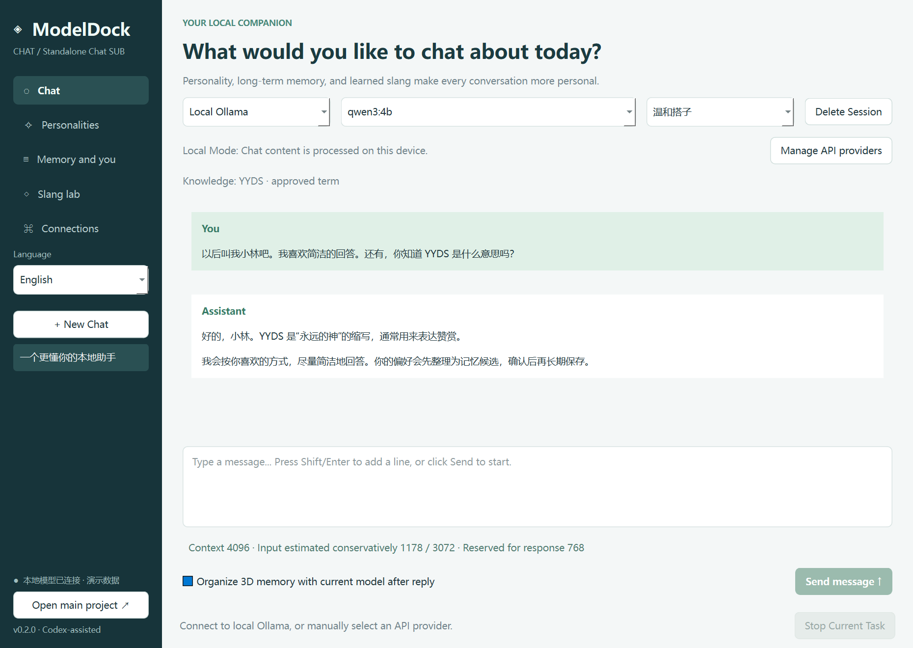
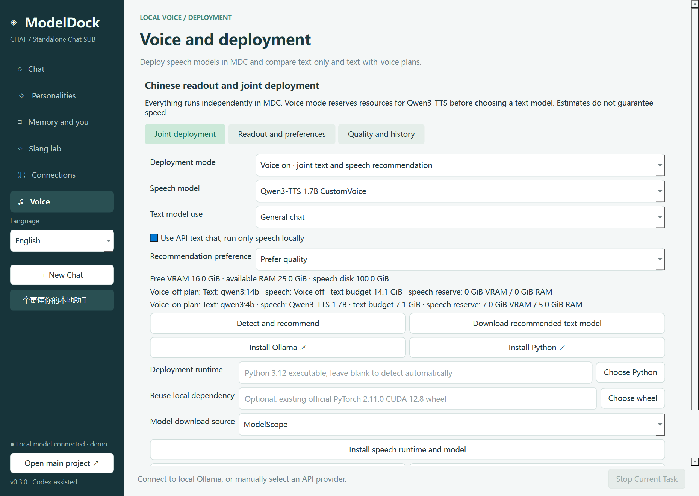

# ModelDock Chat (MDC)

[简体中文](README.md) | **English**

**MDC is an independent SUB / companion project of [ModelDock-Windows (MD)](https://github.com/reaiksp/ModelDock-Windows).** MD deploys local models; MDC provides conversations, personalities, user memory and slang knowledge. Both projects have separate repositories, applications and data directories.

Development assistance: **OpenAI Codex**. The initial application code and documentation were developed with Codex assistance.

Repository: [reaiksp/ModelDock-Chat](https://github.com/reaiksp/ModelDock-Chat). Version: **0.2.0**.

## In-app language switching and user input

Use **Language / 语言** in the sidebar to switch immediately between Simplified Chinese and English. The choice persists across restarts. AI reply language is a separate preference: follow the user's input, Simplified Chinese, or English. An explicit reply preference is included in the request; changing the interface language does not change that preference.

Typed input, personalities, provider/model names and memory records retain their original text. Internal configuration values remain stable across locales. MDC keeps unsent drafts per conversation and includes language-adaptation instructions in context budgeting. The application adapts a copy of the outgoing prompt; stored user messages are not rewritten.



## Get started

Extract the complete Windows x64 portable package and run `ModelDockChat.exe`. Keep `_internal` next to the executable. Basic chat does not require Python. Optional speech deployment needs a separate Python 3.12 installation.

For local chat, install [Ollama](https://ollama.com/download/windows), then detect hardware and download a recommended text model in MDC's Voice & deployment page. Existing MD / Ollama models remain compatible. MDC restores its own selected model first and can read MD's preference during initial setup without modifying MD settings.

For API chat, open **Manage API providers** from the chat page (also available in the slang page's provider tab). Add a named provider, then manually enter its Base URL, model ID, API key and context capacity. Save the profile and select it in the main chat provider dropdown. Multiple profiles can be saved and selected independently for chat and slang learning.

## Local readout and joint deployment (0.3.0)

This update lives entirely in **MDC**; MD does not need an update. A separate local Python process runs Qwen3-TTS and exposes an authenticated loopback interface. Ollama remains the text engine.

1. Open **Voice & deployment**, detect hardware and compare text-only and text-with-voice plans. Choose chat/coding use and speed/balanced/quality preference.
2. The default is **Qwen3-TTS 1.7B CustomVoice**. 0.6B and automatic pairing are also available. Automatic quality mode prefers a feasible 1.7B pairing; other modes weigh the remaining text-model budget.
3. For cloud API text chat, select “Use API text chat; run only speech locally”. This affects recommendation budgets only; select the actual provider in main chat.
4. Enable voice, select a Python 3.12 executable (source runs can detect it; packaged runs can use Python Launcher), choose ModelScope or Hugging Face, then install the isolated runtime and model. Initial downloads require internet, time and disk space. Cancelled downloads can be retried; failed installation is never reported as complete. An existing official `torch-2.11.0+cu128-cp312-cp312-win_amd64.whl` can be reused to avoid another large download; it still installs into the isolated environment.
5. Start/connect the speech service. The model loads on first readout. Select a voice, readout language and optional style instruction. **Only 1.7B supports style instructions.** Playback speed is adjusted by the player.
6. Click **Read this reply** under a completed AI message, read the latest reply or selected chat text. Segmented generation supports playback, pause, stop, optional automatic readout and regeneration. Completed segments survive failure; choose a previous run to replay, or regenerate the message.



Resource estimates assume Q4 text models at 4K context. Speech reservations are 4 GiB VRAM / 4 GiB RAM for 0.6B and 7 GiB VRAM / 5 GiB RAM for 1.7B, in addition to system headroom. Disk checks reserve space for model weights, dependencies and downloads, and combine text/speech needs on the same drive. These are conservative planning budgets, not official minimum requirements or speed guarantees. Managed speech deployment currently targets NVIDIA CUDA GPU index 0 with CUDA 12.8 PyTorch; GPU memory is never combined across cards or with shared RAM. CPU text inference remains supported, but concurrent CPU TTS is not recommended. Already-loaded models reduce measured free memory; stop unused models and detect again. Longer chat contexts cost more memory. Recommendations do not silently replace manually selected chat models.

The isolated runtime is under `%LOCALAPPDATA%/ModelDockChat/speech`; audio cache is under `speech_audio`. Speech dependencies do not enter the chat application's environment. Stopping a managed service releases its resources. Disabling voice or closing its owning MDC instance stops that service.

Original user input, replies, persona prompts and memories stay unchanged. Markdown/code cleanup and literal `term=reading` pronunciation entries apply only to a readout copy. Manually add confirmed slang pronunciations; this does not change model weights or automatically trust learned pronunciations. Full persona prompts are not sent to TTS: enter a short instruction under Voice style preference. Voice, language, style, playback speed and pronunciations persist independently of UI language.

Quality reviews are separate from user-memory scores. Objective checks report segment duration, generation time, low-amplitude sample ratio and clipping ratio; these do not measure semantic accuracy or naturalness. After listening, rate accuracy/naturalness/clarity from 1 to 10 and add a summary and analysis. This version has no ASR back-check or automatic naturalness scoring. Audio and reviews remain local. Clear audio cache without deleting text/reviews; deleting a chat session deletes linked speech text/reviews, while leftover audio can be cleared separately.

Official sources: [Qwen3-TTS](https://github.com/QwenLM/Qwen3-TTS), [1.7B CustomVoice](https://huggingface.co/Qwen/Qwen3-TTS-12Hz-1.7B-CustomVoice), [0.6B CustomVoice](https://huggingface.co/Qwen/Qwen3-TTS-12Hz-0.6B-CustomVoice). Official model cards specify Apache-2.0. Speech weights, PyTorch and CUDA are downloaded separately and are not bundled in the portable application.

## Provider compatibility

MDC supports the **OpenAI-compatible Chat Completions protocol** at `<Base URL>/chat/completions`, not every vendor's native API. For example, a Base URL may end in `/v1` or `/api/v1`; use the exact value documented by your provider. HTTPS is required for non-loopback addresses.

Profiles include:

- A user-chosen provider name, Base URL and model ID.
- The model's context capacity, supplied by the user.
- Optional SSE streaming; disable it for providers requiring ordinary JSON replies.
- Output-budget parameter selection: `max_tokens` or `max_completion_tokens`.
- Optional `reasoning_effort`; leave it at default unless the selected provider/model supports it.

The streaming parser supports heartbeat comments, multiline SSE data, Unicode, usage-only frames and interrupted streams. Structured memory/slang requests use non-streaming JSON content so incomplete results are not mistaken for valid records. HTTP/stream errors do not echo raw provider error bodies that could contain secrets.

When API chat is selected, **the current conversation, personality, user profile, approved memories and retrieved knowledge are sent to that provider**. Memory analysis and continuation summaries use the selected chat provider too. Changing providers starts a separate conversation; existing conversations keep their provider association. The selection indicates configuration, not a successful live authentication check; sending a request verifies actual access.

## Three-dimensional memory

Each memory has three fields:

1. **Score (1–10):** long-term reference value of this information, not a rating of the user. Higher scores are prioritized within the retrieval budget.
2. **Summary:** a concise fact, preference or goal explicitly supported by the user's statement.
3. **Analysis:** why it may be useful and in what context, without inventing unsupported personal traits.

AI-generated candidates require a quotation found in the user's original messages. Assistant replies are not evidence of user facts. Candidates are pending until the user approves them. All three fields can be edited; edits require approval again. Users may also add memories manually.

Existing 0.1 databases upgrade automatically: IDs, approval state, evidence and content are preserved; score defaults to 5, summary is copied from the original content, and analysis starts empty. No existing memory is deleted. Conversation provider associations also migrate with local Ollama as the default.

## Slang learning with the new API system

The slang page can **follow the main chat provider**, use local Ollama, or select any saved provider independently. Learning always uses separate requests containing only its instructions and the material pasted into the learning page. It does not include chat history, personal memories or the user profile, even when it uses the same provider as chat.

Long material is split into fresh requests according to the selected model's context budget. Results become pending terms with definitions, examples, aliases and provenance. Review and approve them before the main AI can retrieve them. Approved terms work with both local and API chat. JSON vocabulary import/export remains available.

A provider's context limit is user-declared; check its model documentation. Invalid JSON, truncated structured output, permission errors and network failures are reported, while previously completed batches remain available for review.

## Context and input limits

Local model capacity is read from Ollama metadata, falling back to 4K. API model capacity comes from the saved profile. Input estimates include personality, user data, approved memories, retrieved slang, summary and history; reply and safety budgets are reserved.

The UI warns near the limit and blocks a single oversized message without deleting the text. Overlong history is summarized into a linked continuation conversation; original history remains available. Personality prompts are also checked. Estimates use conservative UTF-8 bytes plus message overhead, **not an exact model tokenizer**. Summaries may omit details.

## Knowledge storage and model variants

Slang persists in the independent SQLite knowledge database and is retrieved by matching terms or aliases. This is keyword retrieval, not vector search or weight training.

With **local Ollama selected**, approved slang and a personality can be saved as a new Ollama model variant through `/api/create`. This stores a system-prompt snapshot and preserves the original model weights. Personal memories and user profile are excluded. The function is unavailable for external chat APIs; it does not upload a local model or train a provider's model.

## Data and API keys

MDC data lives in `%LOCALAPPDATA%\ModelDockChat\chat.db`. Chat, personality, memory, vocabulary and learning records persist locally; the database itself is not encrypted.

Keys remain in memory unless Windows-encrypted saving is selected. Each provider has a separate Windows DPAPI file. Provider metadata contains no API keys. Old learning-provider configuration and its encrypted key remain compatible. Deleting a profile removes its saved key but preserves conversations.

## Development

Python 3.12 on Windows x64:

```powershell
python -m venv .venv
.\.venv\Scripts\python.exe -m pip install -r requirements-dev.txt
.\.venv\Scripts\python.exe main.py
.\.venv\Scripts\python.exe -m pytest -q
powershell -ExecutionPolicy Bypass -File .\build.ps1
```

Build output includes a portable directory, ZIP, SHA256, dynamic Qt libraries, licenses and application source. This is an unsigned test build. Automated API tests use a controlled local compatible server; real third-party accounts need separate verification with the user's credentials. See [release notes](RELEASE_NOTES.md) and [third-party notices](THIRD_PARTY_NOTICES.md).

## Ollama and protocol references

MDC is an independent project, not an official Ollama client. Ollama and model weights are installed separately and governed by their own licenses. References: [Ollama CLI](https://github.com/ollama/ollama), [Ollama chat API](https://docs.ollama.com/api/chat), [model creation](https://docs.ollama.com/api/create), [DeepSeek Chat Completions](https://api-docs.deepseek.com/api/create-chat-completion/), [OpenRouter streaming](https://openrouter.ai/docs/api_reference/streaming).


## Voice validation notes

The default 1.7B model generated two Chinese PCM WAV segments locally on an RTX 5080 using PyTorch 2.11.0 CUDA 12.8 and SDPA. Audio durations were 3.84s and 2.56s; the first request, including cold model loading, took 66.61s, and the next segment took 3.55s. Objective checks found no near-silence or clipping warning. This is not a listening-based accuracy or naturalness score. 0.6B has interface/resource coverage but has not undergone a real-weight inference acceptance run. Windows audio-handle cleanup is regression-tested to prevent WinError 32 on exit. This remains an unsigned test build.

To repeat actual synthesis, install development requirements and run `python tools/speech_smoke.py --root artifacts/voice-test --install --size 1.7B --source modelscope`. Optionally pass `--torch-wheel` with an existing official PyTorch wheel. This command downloads large dependencies/models only when `--install` is specified, uses an isolated test environment and stops its service afterward.
