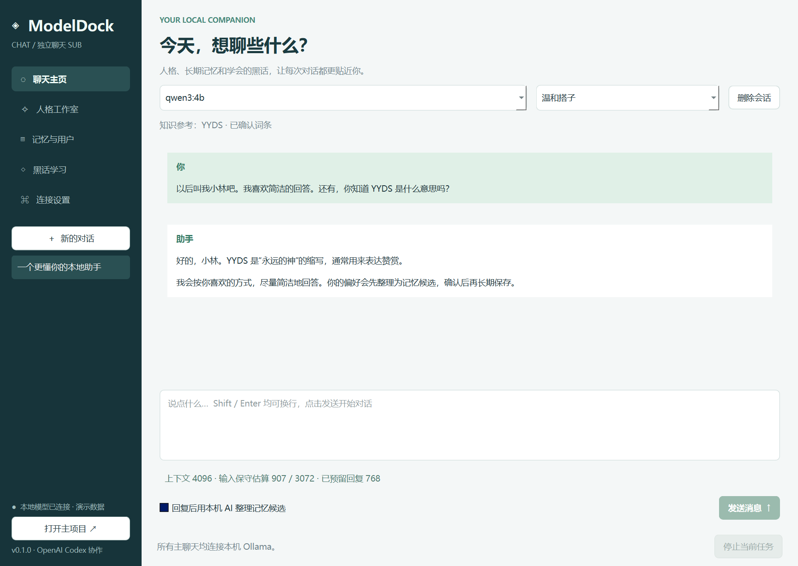

# ModelDock Chat

**这是 [ModelDock-Windows](https://github.com/reaiksp/ModelDock-Windows) 的独立 SUB 配套项目。** ModelDock 负责在本机部署模型，ModelDock Chat 提供图形化聊天、人格提示词、用户记忆与黑话学习。两个项目拥有独立仓库、程序和数据目录，通过 Ollama 本地 API 连接。

开发协作署名：**OpenAI Codex**（AI 编程助手）。本项目初版代码与文档由 Codex 协助完成。

仓库：[reaiksp/ModelDock-Chat](https://github.com/reaiksp/ModelDock-Chat) · 主项目：[reaiksp/ModelDock-Windows](https://github.com/reaiksp/ModelDock-Windows)



## 开始使用

适用 Windows 10 22H2 / Windows 11 x64。完整解压便携发行包后运行 `ModelDockChat.exe`，保留同目录的 `_internal` 文件夹；用户无需安装 Python。

1. 在 [ModelDock 主项目](https://github.com/reaiksp/ModelDock-Windows) 部署一个文字模型，也可使用自己安装的 Ollama 与本地模型。
2. 打开本 SUB，自动连接 `http://127.0.0.1:11434`。点击“连接设置 → 一键连接”可再次连接，服务未启动且能找到 Ollama CLI 时会自动启动。
3. 若主项目保存过模型偏好，优先选用该模型，否则选择已安装的本地模型。不会修改主项目的设置或模型文件。
4. 在聊天主页选择人格并发送消息。后续可在“人格工作室”“记忆与用户”“黑话学习”中调整。

本软件的主聊天始终使用本机 Ollama，不需要云端 API Key。独立学习 API 的配置只出现在“黑话学习”页面。

## 聊天与提示词长度限制

- 主页面支持流式回复、停止生成、会话历史、删除会话和多个人格。
- 从 `/api/show` 的模型元数据读取最大上下文，识别失败时使用保守的 4096 上限；可在连接设置中选择模型支持范围内的 2K / 4K / 8K / 16K / 32K。
- 默认使用 4K，预留 768 的回复空间及 256 的安全空间；更大的上下文会增加内存和显存占用。
- 输入框实时显示包含人格、用户资料、记忆、检索词条、摘要和消息历史的预算估算。接近上限会提醒；**单条消息本身超限时警告并禁用发送，原文保留**。
- 人格提示词也按当前上下文检查，超限不能保存。用户资料限制为 500 UTF-8 字节，单条记忆也有长度限制。
- 当历史过长但新消息本身能容纳时，使用本机模型压缩摘要，**新建有父会话关联的续聊会话**。原始历史保留；摘要可能丢失细节，可回到原会话查看。
- 长度使用 UTF-8 字节和固定消息开销作保守估算，**不是模型精确 tokenizer 数量**。特殊模型模板仍可能增加额外开销。程序会在每次实际请求前再次检查预算。
- 失败或主动停止的消息会标记为中断，已生成文本保留，但不会作为完成的历史传入下一轮。

## 人格、用户与长期记忆

人格工作室提供预设和自定义人格；切换人格会开启新会话，修改已保存人格在后续请求生效。

用户可填写称呼、回答风格、目标等资料，或手动添加长期记忆。可手动请求本地 AI 分析当前会话，也可勾选“回复后整理记忆候选”。分析仅使用**用户消息**，候选必须提供能在原文中找到的证据；AI 回复不会作为用户事实。

AI 整理的记忆先保存为“待确认”，**确认后才参与主聊天**。用户可以编辑和删除；编辑后需要重新确认。程序不会把 AI 推测当成已确认的人格或用户身份。

## 黑话学习与独立提供商 API

“黑话学习”包含学习台、学习提供商 API、词库与模型三个子页面。

1. 粘贴黑话、缩写、释义、例句或圈内对话。
2. 选择本机模型，或填写独立提供商的 Base URL、模型 ID、API Key 和上下文容量。支持 OpenAI 兼容 `/chat/completions` 格式，例如 Base URL 为 `https://提供商地址/v1`。
3. 点击开始学习。长材料按提供商上下文拆分，**每段使用全新的独立请求**，不带主聊天历史；总材料上限 200,000 UTF-8 字节。
4. 结果整理成有来源的待确认词条。在“词库与模型”中审核、编辑并确认，下一轮主聊天遇到对应词或别名时自动检索其释义和例句。

**使用外部学习 API 时，只发送用户在学习台粘贴的材料**，不发送主聊天、人格、用户资料和记忆。外部服务仍会按其自身政策处理这些材料。主聊天界面不会显示或调用该外部提供商配置。

提供商的上下文容量由用户按模型说明填写。无效 JSON、响应截断、网络失败或权限问题会显示错误；先前成功批次的候选会保留以供审核。学习材料和结果保存在本地独立学习记录中。

支持手动添加、修改、删除黑话词条，支持导入 / 导出 JSON 词库；导入的词条默认待确认。导出只包含已确认词条，不包含聊天和个人记忆。

## 能否把黑话加进原来的模型？

当前实现两种持久化方式：

1. **本地知识库 + 检索**：黑话写入独立 SQLite 数据库，主 AI 根据当前消息中的词语 / 别名检索使用。词条较多时推荐这种方式；目前是词语匹配检索，不是语义向量检索。
2. **Ollama 派生模型**：在“词库与模型”点击“保存为 Ollama 派生模型”，将当前人格与全部已确认黑话固化为一个新模型的系统提示。原模型保留，新名称不能覆盖已有模型，其他 Ollama 客户端也能选用它。用户资料和个人记忆不会被导入派生模型。

派生模型通过 Ollama `/api/create` 实现，**不修改原模型权重，不是训练或微调**。它是创建时的词库快照，后续词库改动需以新名称重新创建。词条总量超过模型上下文时会阻止创建，建议继续使用检索。

## 数据与兼容性

本 SUB 使用 `%LOCALAPPDATA%\ModelDockChat\chat.db` 保存自己的会话、人格、资料、记忆、词库和独立学习记录。不会导入或修改主项目的数据。连接时仅读取主项目 `%LOCALAPPDATA%\ModelDock\settings.json` 中选择的模型名。

API Key 默认只在当前进程内存使用；勾选保存后，由 Windows 当前用户的 DPAPI 加密写入 `learning-key.dpapi`。取消保存并点击保存配置会删除密钥文件。**聊天数据库本身未加密**，请按个人文件管理。主聊天正文与密钥不会写入应用日志。

兼容接口：`GET /api/tags`、`POST /api/show`、`POST /api/chat`；创建派生模型使用 `POST /api/create`。不依赖主项目 Python 包，也不要求两个项目安装在同一目录。

## Ollama CLI 声明

本项目是独立的图形化聊天 SUB，通过 [Ollama 官方 CLI](https://github.com/ollama/ollama) 与本地 API 使用已部署模型。它不是 Ollama 官方客户端，与 Ollama 项目无隶属关系。Ollama 和模型权重由用户另行安装 / 部署，遵循各自许可证。

官方资料：[Windows 安装](https://docs.ollama.com/windows)、[聊天 API](https://docs.ollama.com/api/chat)、[创建模型](https://docs.ollama.com/api/create)、[Ollama LICENSE](https://github.com/ollama/ollama/blob/main/LICENSE)。第三方组件说明见 [THIRD_PARTY_NOTICES.md](THIRD_PARTY_NOTICES.md)。

## 开发与打包

Python 3.12 / Windows x64：

```powershell
python -m venv .venv
.\.venv\Scripts\python.exe -m pip install -r requirements-dev.txt
.\.venv\Scripts\python.exe main.py
.\.venv\Scripts\python.exe -m pytest -q
powershell -ExecutionPolicy Bypass -File .\build.ps1
```

打包会生成 `dist/ModelDockChat/ModelDockChat.exe`、便携 ZIP 和 SHA256 文件。Qt / PySide6 动态库、许可证与应用源码随包分发，便于替换库与重新构建。当前是未签名测试版；不同驱动、提供商以及干净 Windows 环境仍需分别验收。

本机真实联调（需要已有 Ollama 模型，不下载新权重，不创建持久派生模型）：

```powershell
.\.venv\Scripts\python.exe tools\integration_smoke.py
```

联调会临时创建一个随机命名的测试派生模型以验证词库固化，验证后自动删除；不会修改原模型。界面完整流程可用 `tools/ui_smoke.py` 验证。版本验证范围见 [RELEASE_NOTES.md](RELEASE_NOTES.md)。

核心模块：`chatdock/store.py` 为独立数据库，`network.py` 为 API / CLI 连接，`context.py` 为上下文预算，`engine.py` 为对话 / 记忆 / 学习流程，`ui.py` 为原生桌面界面，`secrets.py` 为密钥保存。
