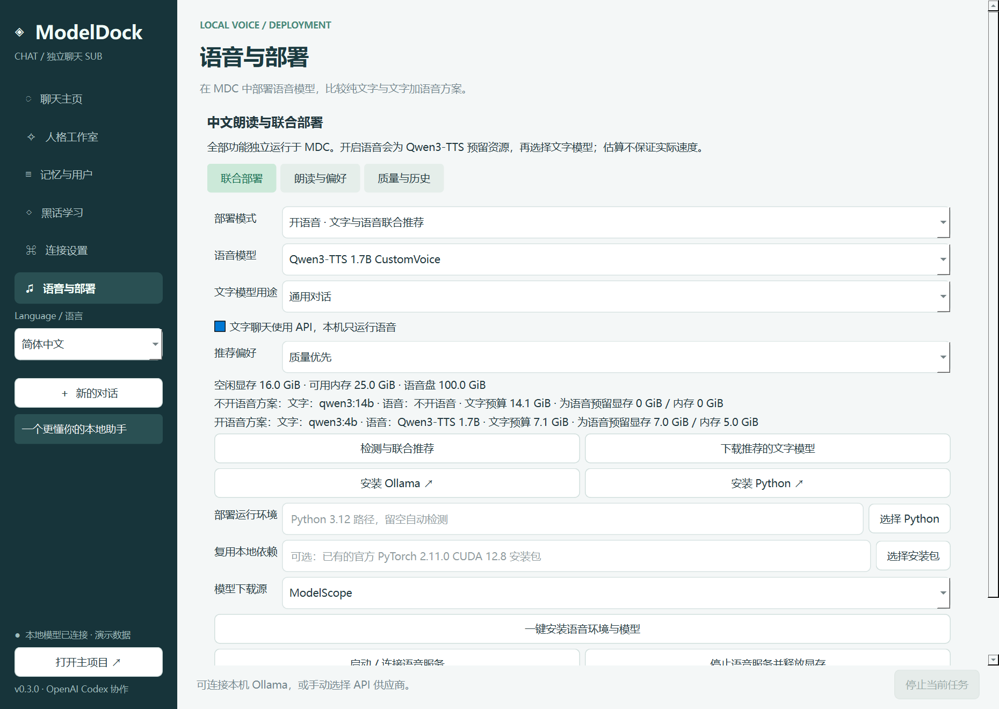

# ModelDock Chat

**简体中文** | [English](README.en.md)

**这是 [ModelDock-Windows](https://github.com/reaiksp/ModelDock-Windows) 的独立 SUB 配套项目。** ModelDock Chat 提供本地 / API 图形化聊天、人格提示词、三维用户记忆、黑话学习及独立的本地语音部署。两个项目拥有独立仓库、程序和数据目录，通过 Ollama 本地 API 连接。

开发协作署名：**OpenAI Codex**（AI 编程助手）。本项目初版代码与文档由 Codex 协助完成。

仓库：[reaiksp/ModelDock-Chat](https://github.com/reaiksp/ModelDock-Chat) · 主项目：[reaiksp/ModelDock-Windows](https://github.com/reaiksp/ModelDock-Windows)


## 应用内中英文与输入适配

侧栏 **Language / 语言** 可即时切换简体中文与 English，重启后保留。界面语言与 AI 回复语言独立：聊天页或连接设置中可选“跟随用户输入 / 简体中文 / English”。明确语言偏好会加入请求提示；界面切换不会改写用户的输入文字、人格提示词、供应商 / 模型名或记忆原文。

推荐用途、速度 / 质量偏好与 API 配置使用稳定内部值，不因翻译改变。请求的语言适配开销会参与 MDC 的上下文预算。MDC 还会按会话保存未发送草稿，切换和重启后可恢复。

## 开始使用

适用 Windows 10 22H2 / Windows 11 x64。完整解压便携发行包后运行 `ModelDockChat.exe`，保留同目录的 `_internal` 文件夹；基础聊天无需安装 Python；可选的语音模型部署需要独立 Python 3.12 环境。

1. 安装 [Ollama](https://ollama.com/download/windows) 后，在 MDC 的“语音与部署”页面检测配置并通过 Ollama CLI 下载文字模型；也可复用 [ModelDock 主项目](https://github.com/reaiksp/ModelDock-Windows) 部署的模型。
2. 打开本 SUB，自动连接 `http://127.0.0.1:11434`。点击“连接设置 → 一键连接”可再次连接，服务未启动且能找到 Ollama CLI 时会自动启动。
3. 优先恢复 MDC 已选择的模型；首次连接时可读取主项目偏好，否则选择已安装模型。不会修改主项目的设置。
4. 在聊天主页选择人格并发送消息。后续可在“人格工作室”“记忆与用户”“黑话学习”中调整。

本软件支持本机 Ollama 和手动选择的 API 供应商。点击主页“管理 API 供应商”，填写供应商名称、Base URL、模型 ID、Key 和上下文，保存后在主页下拉框选择。可保存多个供应商，黑话学习可跟随主聊天或单独选择。

API 使用 OpenAI 兼容 `/chat/completions`，支持 SSE 流式和普通 JSON。可按供应商要求选择 `max_tokens` / `max_completion_tokens`，以及可选 `reasoning_effort`；不是所有供应商原生协议都兼容。切换供应商会新建会话，旧会话保留供应商关联。

**API 聊天会向选定供应商发送本会话、人格、用户资料、已确认记忆与检索知识。** 记忆分析、续聊摘要也使用当前聊天供应商。黑话学习仍只发送学习材料，不附带主聊天和记忆。

## 本地中文朗读与联合推荐（0.3.0）

本次更新全部位于 **MDC**，不需要更新 MD。语音由独立本地进程运行，通过带随机令牌的回环接口连接 MDC，不经 Ollama 加载语音权重。

1. 打开“语音与部署”，点击“检测与联合推荐”。页面同时展示“不开语音”和“开语音”两套文字模型搭配，可选择通用 / 编程、均衡 / 速度 / 质量偏好。
2. 选择语音模型：默认 **Qwen3-TTS 1.7B CustomVoice**，另提供 0.6B 与自动搭配。自动模式会综合文字模型与语音资源；质量优先时优先考虑可容纳的 1.7B 搭配。
3. 若文字使用云端 API，可勾选“文字聊天使用 API，本机只运行语音”；此选项只影响推荐预算，实际供应商仍在主聊天选择。
4. 开启语音，选择 Python 3.12 的 `python.exe`（源码运行可自动检测，便携版可使用 Python Launcher），选择 ModelScope 或 Hugging Face，点击“一键安装语音环境与模型”。依赖安装和模型下载需要网络，首次耗时较长；取消后可重试。应用不会把下载失败标记为安装成功。可选择已有的官方 `torch-2.11.0+cu128-cp312-cp312-win_amd64.whl` 以减少重复下载，依然安装到独立环境。
5. 点击“启动 / 连接语音服务”。首次朗读加载权重；配置音色、朗读语言、语气偏好及播放速度。**语气指令仅用于 1.7B**，播放速度由播放器调整。
6. 在任意完整 AI 回复下点击“朗读这条回复”，或朗读最新回复 / 聊天选中文字。支持分段生成、播放、暂停、停止、重新生成与可选自动朗读。失败后已完成分段保留，可在生成历史中播放或重新生成整条。



**资源估算**：按 4K 上下文、Q4 文字模型估算；0.6B 语音预留 4 GiB 显存 / 4 GiB 内存，1.7B 预留 7 GiB 显存 / 5 GiB 内存，再加系统余量。语音模型盘另预留模型、依赖和下载空间；与文字模型同盘时合并检查。数值是保守选型预算，并非官方最低配置或本机性能承诺。当前自动部署面向 NVIDIA CUDA 单卡（索引 0，CUDA 12.8 PyTorch）；不合并多卡，不把共享显存加到独立显存。CPU 文字聊天继续可用，但不推荐 CPU 同时运行此语音模型。已经加载的模型会占用空闲资源，使推荐更保守；停止不用的模型后重新检测。更长上下文会额外占用资源，联合推荐不会强制替换用户手动选择的文字模型。

语音运行环境位于 `%LOCALAPPDATA%/ModelDockChat/speech`，音频缓存位于 `speech_audio`；语音依赖不会安装到 MDC 聊天环境。关闭由当前 MDC 启动的服务或退出应用会释放该服务的显存；切换到不开语音时会停止当前应用管理的语音服务。

原始输入、AI 回复、人格、记忆均保留。Markdown 和代码处理、`词语=朗读方式` 发音词典只作用于朗读副本；用户可手动将确认过的黑话读法填入词典，不会修改文字模型权重或自动采用未审核读法。人格提示词不会整段发送给语音模型：请在“个人语气偏好”填写简短朗读指令。音色、语气、语言、语速与词典独立保存，不随界面语言切换。

**质量评价**与用户记忆评分独立：程序记录各段时长、生成耗时、低幅度样本比例和削波比例，异常提示不等于语义质量分；试听后手动填写准确度 / 自然度 / 清晰度各 1–10，以及概述和分析。首版不含语音识别回读或自动自然度打分。音频与评价仅本地保存，可清理音频缓存；缓存清理保留文字与评价，删除聊天会话会删除关联语音文字 / 评价，残余音频需清理缓存。

模型来自 [Qwen3-TTS 官方项目](https://github.com/QwenLM/Qwen3-TTS) 与官方模型仓库：[1.7B](https://huggingface.co/Qwen/Qwen3-TTS-12Hz-1.7B-CustomVoice)、[0.6B](https://huggingface.co/Qwen/Qwen3-TTS-12Hz-0.6B-CustomVoice)。官方模型标注 Apache-2.0；发行包不包含语音权重、PyTorch 或 CUDA，安装时单独下载并遵循相应许可。

## 聊天与提示词长度限制

- 主页面支持流式回复、停止生成、会话历史、删除会话和多个人格。
- 从 `/api/show` 的模型元数据读取最大上下文，识别失败时使用保守的 4096 上限；可在连接设置中选择模型支持范围内的 2K / 4K / 8K / 16K / 32K。
- 默认使用 4K，预留 768 的回复空间及 256 的安全空间；更大的上下文会增加内存和显存占用。
- 输入框实时显示包含人格、用户资料、记忆、检索词条、摘要和消息历史的预算估算。接近上限会提醒；**单条消息本身超限时警告并禁用发送，原文保留**。
- 人格提示词也按当前上下文检查，超限不能保存。用户资料限制为 500 UTF-8 字节，单条记忆也有长度限制。
- 当历史过长但新消息本身能容纳时，使用本机模型压缩摘要，**新建有父会话关联的续聊会话**。原始历史保留；摘要可能丢失细节，可回到原会话查看。
- 长度使用 UTF-8 字节和固定消息开销作保守估算，**不是模型精确 tokenizer 数量**。特殊模型模板仍可能增加额外开销。程序会在每次实际请求前再次检查预算。
- 失败或主动停止的消息会标记为中断，已生成文本保留，但不会作为完成的历史传入下一轮。

## 人格、用户与长期记忆

人格工作室提供预设和自定义人格；切换人格会开启新会话，修改已保存人格在后续请求生效。

用户可填写称呼、回答风格、目标等资料，或手动添加长期记忆。可手动请求当前聊天模型分析当前会话，也可勾选“回复后整理记忆候选”。分析仅使用**用户消息**，候选必须提供能在原文中找到的证据；AI 回复不会作为用户事实。

AI 整理的记忆先保存为“待确认”，**确认后才参与主聊天**。用户可以编辑和删除；编辑后需要重新确认。

每条记忆有三个维度：**评价 1–10（长期参考价值，不是对用户的评价）、概述、分析**。分析说明原文依据与使用场景，不应增加无依据推断。已确认记忆在上下文预算内优先使用高分项。

旧版记忆库自动兼容升级：记录、证据和审批状态保留，评分默认为 5，概述沿用原内容，分析为空。程序不会把 AI 推测当成已确认的人格或用户身份。

## 黑话学习与独立提供商 API

“黑话学习”包含学习台、聊天 / 学习供应商、词库与模型三个子页面。供应商管理可同时供主聊天和黑话学习选择。

1. 粘贴黑话、缩写、释义、例句或圈内对话。
2. 选择跟随主聊天、本机模型或一个已保存的独立供应商。供应商配置包含 Base URL、模型 ID、API Key 和上下文容量。支持 OpenAI 兼容 `/chat/completions` 格式，例如 Base URL 为 `https://提供商地址/v1`。
3. 点击开始学习。长材料按提供商上下文拆分，**每段使用全新的独立请求**，不带主聊天历史；总材料上限 200,000 UTF-8 字节。
4. 结果整理成有来源的待确认词条。在“词库与模型”中审核、编辑并确认，下一轮主聊天遇到对应词或别名时自动检索其释义和例句。

**使用外部学习 API 时，只发送用户在学习台粘贴的材料**，不发送主聊天、人格、用户资料和记忆。外部服务仍会按其自身政策处理这些材料。主聊天界面不会显示或调用该外部提供商配置。

提供商的上下文容量由用户按模型说明填写。无效 JSON、响应截断、网络失败或权限问题会显示错误；先前成功批次的候选会保留以供审核。学习材料和结果保存在本地独立学习记录中。

支持手动添加、修改、删除黑话词条，支持导入 / 导出 JSON 词库；导入的词条默认待确认。导出只包含已确认词条，不包含聊天和个人记忆。

## 能否把黑话加进原来的模型？

当前实现两种持久化方式：

1. **本地知识库 + 检索**：黑话写入独立 SQLite 数据库，主 AI 根据当前消息中的词语 / 别名检索使用。词条较多时推荐这种方式；目前是词语匹配检索，不是语义向量检索。
2. **Ollama 派生模型**：主聊天选择本机 Ollama 后，在“词库与模型”点击“保存为 Ollama 派生模型”，将当前人格与全部已确认黑话固化为一个新模型的系统提示。原模型保留，新名称不能覆盖已有模型，其他 Ollama 客户端也能选用它。用户资料和个人记忆不会被导入派生模型。

派生模型通过 Ollama `/api/create` 实现，**不修改原模型权重，不是训练或微调**。它是创建时的词库快照，后续词库改动需以新名称重新创建。词条总量超过模型上下文时会阻止创建，建议继续使用检索。

## 数据与兼容性

本 SUB 使用 `%LOCALAPPDATA%\ModelDockChat\chat.db` 保存自己的会话、人格、资料、记忆、词库和独立学习记录。不会导入或修改主项目的数据。连接时仅读取主项目 `%LOCALAPPDATA%\ModelDock\settings.json` 中选择的模型名。

API Key 默认只在当前进程内存使用；勾选保存后，每个供应商由 Windows 当前用户的 DPAPI 分别加密保存。旧版 `learning-key.dpapi` 学习配置仍兼容。取消保存并点击保存配置会删除密钥文件。**聊天数据库本身未加密**，请按个人文件管理。主聊天正文与密钥不会写入应用日志。

兼容接口：`GET /api/tags`、`POST /api/show`、`POST /api/chat`；创建派生模型使用 `POST /api/create`。不依赖主项目 Python 包，也不要求两个项目安装在同一目录。

## Ollama CLI 声明

本项目是独立的图形化聊天 SUB，通过 [Ollama 官方 CLI](https://github.com/ollama/ollama) 与本地 API 使用已部署模型。它不是 Ollama 官方客户端，与 Ollama 项目无隶属关系。Ollama 和模型权重由用户另行安装 / 部署，遵循各自许可证。

官方资料：[Windows 安装](https://docs.ollama.com/windows)、[聊天 API](https://docs.ollama.com/api/chat)、[创建模型](https://docs.ollama.com/api/create)、[Ollama LICENSE](https://github.com/ollama/ollama/blob/main/LICENSE)。第三方组件说明见 [THIRD_PARTY_NOTICES.md](THIRD_PARTY_NOTICES.md)。

## 开发与打包

Python 3.12 / Windows x64：

```powershell
python -m venv .venv
.\.venv\Scripts\python.exe -m pip install -r requirements-dev.txt
.\.venv\Scripts\python.exe main.py
.\.venv\Scripts\python.exe -m pytest -q
powershell -ExecutionPolicy Bypass -File .\build.ps1
```

打包会生成 `dist/ModelDockChat/ModelDockChat.exe`、便携 ZIP 和 SHA256 文件。Qt / PySide6 动态库、许可证与应用源码随包分发，便于替换库与重新构建。当前是未签名测试版；不同驱动、提供商以及干净 Windows 环境仍需分别验收。

本机真实联调（需要已有 Ollama 模型，不下载新权重，不创建持久派生模型）：

```powershell
.\.venv\Scripts\python.exe tools\integration_smoke.py
```

联调会临时创建一个随机命名的测试派生模型以验证词库固化，验证后自动删除；不会修改原模型。界面完整流程可用 `tools/ui_smoke.py` 验证。版本验证范围见 [RELEASE_NOTES.md](RELEASE_NOTES.md)。

核心模块：`chatdock/store.py` 为独立数据库，`network.py` 为 API / CLI 连接，`context.py` 为上下文预算，`engine.py` 为对话 / 记忆 / 学习流程，`ui.py` 为原生桌面界面，`secrets.py` 为密钥保存。
